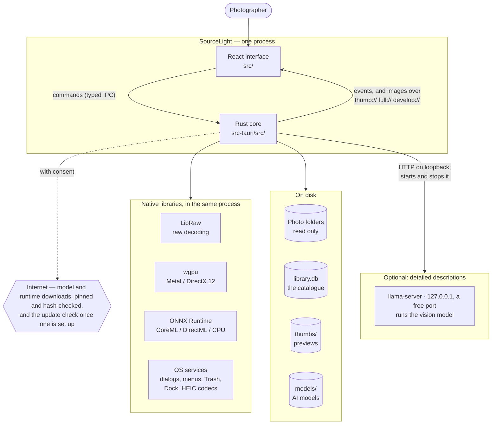
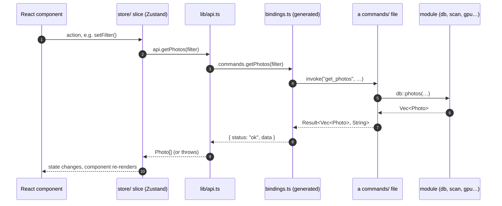
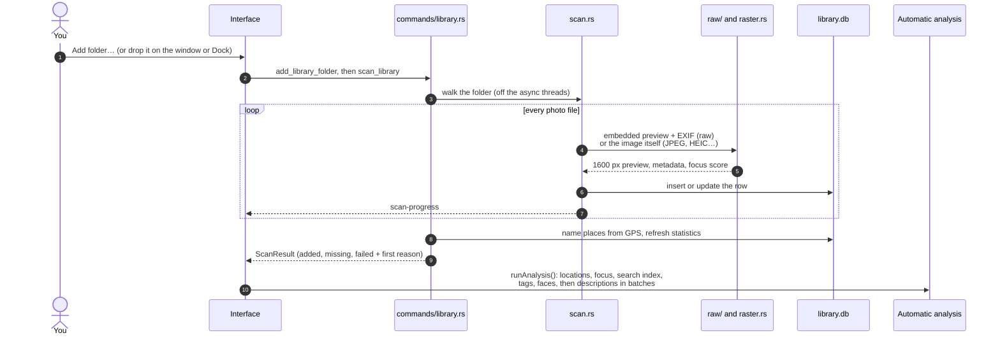
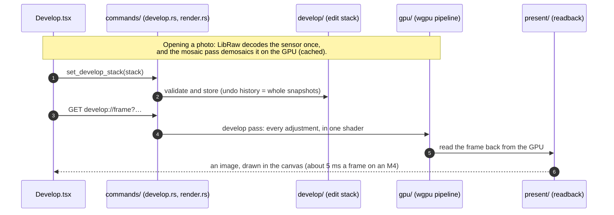
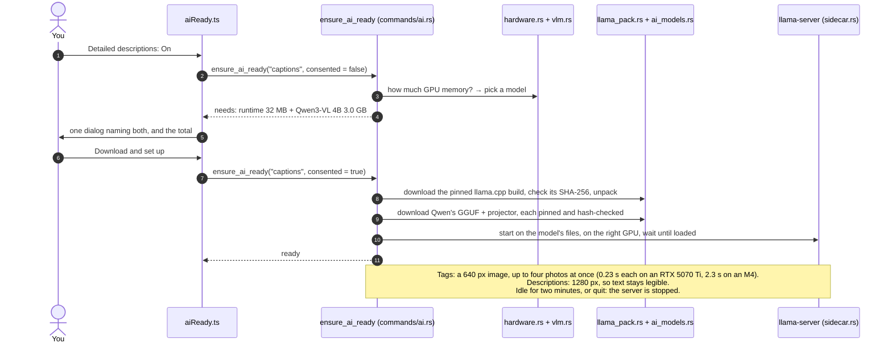
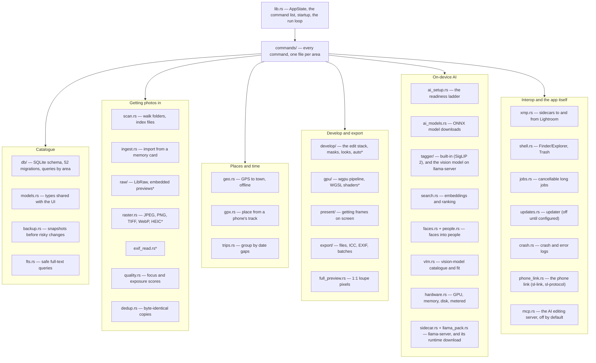
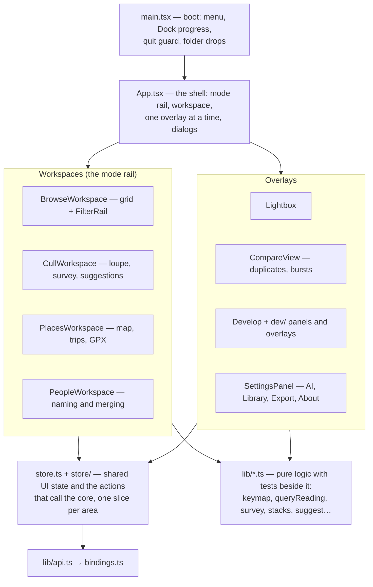
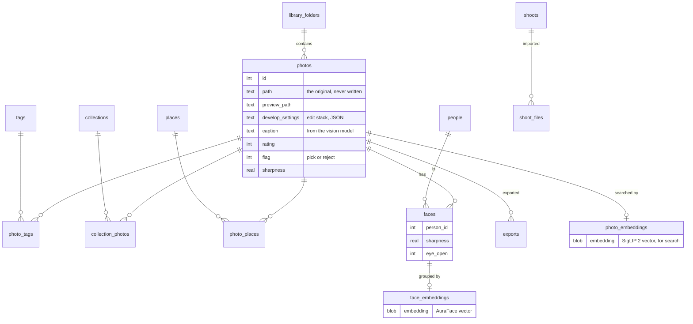

# How SourceLight is built

The map of the system: what runs, where data lives, and how a click becomes
work. Start here, then read [CODEBASE-GUIDE.md](CODEBASE-GUIDE.md) for the
module-by-module tour (with Rust explained along the way).

The diagrams are [Mermaid](https://mermaid.js.org/), which GitHub renders in
place. In an editor, a Mermaid preview extension shows them.

---

## 1. The system at a glance

SourceLight is one desktop app built with **Tauri 2**: a native **Rust core**
that does all the work, and a **React + TypeScript** interface that runs in the
operating system's own webview (WebView2 on Windows, WKWebView on a Mac). The
only other process it ever runs is optional: llama.cpp's **`llama-server`**,
which runs the vision model behind *Detailed descriptions*, started and
stopped by the app itself.



Three rules explain most of the design:

- **The originals are never written.** Everything you decide — ratings, tags,
  places, people, edits — lives in `library.db`. Delete it and you lose the
  notes, never a photo. (Writing an `.xmp` sidecar beside a photo, or moving a
  reject to the Trash, happens only when you ask.)
- **The core owns data and work; the interface only shows and asks.** React
  never touches a file or the database. It calls a command and waits, or
  listens for progress events.
- **The photos stay on the machine.** No account, no telemetry. The network
  is used to download models and the llama.cpp runtime, each pinned to a
  version and checked against a SHA-256 in the source, and to check for
  updates once an update server is set up. A photo leaves only for a phone
  the user pairs, or for an AI app the user connects to the editing server.
  [PRIVACY.md](../PRIVACY.md) lists every request.

---

## 2. The interface ↔ core bridge

Every feature is a variation of the same loop.



- **Commands** are Rust functions marked `#[tauri::command]` and
  `#[specta::specta]`, one file per area in `commands/`, and listed in
  `specta_builder()` in `lib.rs` (234 of them). `export_bindings` generates
  `src/bindings.ts` from them, so the two languages always agree on types. `./scripts/check.sh` fails if the file is
  stale.
- **Where a command runs.** A plain `#[tauri::command]` on a sync function
  runs on the **main thread**: while it works, the window, its menus and every
  other command wait. That is right for quick setters that must apply in
  order (a rating, a slider). Anything that reads a lot, touches the disk or
  runs a model is `#[tauri::command(async)]`, which runs the same body on a
  worker thread; its answers can then arrive out of order, so the interface
  keeps only the latest (`reloadSeq` in `store/library.ts`). One deliberate
  exception: `render_direct`, which draws Develop's photo into the GPU layer
  beneath the page, stays on the main thread — it moves that layer, which is a
  window operation, and done there the move lands with the frame drawn into
  it. It costs about 2 ms a frame. Develop's histogram is async.
- **Events** go the other way: long jobs `emit` progress (`scan-progress`,
  `caption-progress`, `ai-download-progress`…) and the interface `listen`s.
- **Custom URL schemes** carry images, which are too big for JSON:
  `thumb://` serves cached previews, `full://` the full-resolution embedded
  JPEG for a 1:1 loupe, `develop://` each rendered Develop frame. All three
  are asynchronous, so a slow file never blocks the window.

---

## 3. What happens when…

### …you add a folder



**Why previews, not full decodes.** Every raw embeds a camera-rendered JPEG.
Extracting it costs milliseconds; demosaicing the sensor costs seconds. So the
library runs entirely on previews, and the sensor is decoded only when a photo
is opened in Develop or exported.

### …you drag a slider in Develop



The edit stack is a few hundred bytes of versioned JSON in the photo's
`develop_settings` column. Export runs the *same* shader at full resolution,
so the preview and the file cannot disagree.

### …you turn on Detailed descriptions



It replaced a private Ollama, whose API made every photo slower: see
[AI-MODEL-SPIKES.md](AI-MODEL-SPIKES.md). On Windows the runtime is the Vulkan
build, which runs NVIDIA, AMD and Intel GPUs alike and falls back to the CPU;
the server runs on the GPU the other models use, or on the CPU when
there is only integrated graphics. There it also runs in a job object the app
holds, so it ends with the app even when the app crashes or is ended from Task
Manager (`sidecar::die_with_app`).

The same ladder serves every AI feature. For the ONNX models (search, tags,
faces, masks) it downloads into `models/` instead, and nothing needs a server.

---

## 4. The Rust core, by responsibility



\* In the develop core, `src-tauri/crates/sl-develop`, which the phone app
shares. `lib.rs` re-exports it under the same names, so the rest of the app
reads `crate::gpu` or `crate::raster` as before. The app's own `develop/` and
`raw/` add what only the desktop does: LibRaw (`raw/libraw.rs`), the AI masks,
noise reduction's and erase's models, and Develop's live state
(`develop/session.rs`).

Platform-specific code is kept in a few named places, each with a Windows and
a Mac branch: `present/` (drawing frames), `hardware.rs` (memory, metered
network), `raster/wic.rs` and `raster/imageio.rs` in sl-develop (HEIC),
`shell.rs` and `sidecar.rs` (stopping the
vision model's server, and on Windows the job object that ends it with the
app). Everything else — SQLite, wgpu, LibRaw, ONNX Runtime — is portable.

---

## 5. The interface, by responsibility



`npm run dev` on its own serves this interface to a browser with
`src/dev/mockBackend.ts` standing in for the core: a fake 48-photo library for
looking at layout without Tauri.

---

## 6. Where the data lives

```
<app data>/                      app.sourcelight in the OS's
│                                app-data folder, or SOURCELIGHT_DATA_DIR
├── library.db                   the catalogue (SQLite, WAL mode)
├── backups/                     catalogue snapshots: daily (a week kept), before
│                                upgrades and re-tags (3 kept), and manual ones
├── thumbs/                      <hash>_p.jpg previews, <hash>_t.jpg thumbnails
├── luts/                        imported .cube looks
├── logs/                        crash and interface error logs
├── models/                      ONNX models: siglip2/, faces/, birefnet(_fp16).onnx, sam2/
│   └── vision/                  the vision models' GGUFs, if downloaded
└── llama-runtime/               llama.cpp's llama-server, if downloaded
```

The catalogue's main tables:



Also: `trips`, `smart_collections`, `presets`, `face_links` and
`people_apart` (faces you said are, or are not, the same person), `settings`
(key–value), and `captions_fts` (full-text index over captions,
kept in step by triggers). The schema only ever grows by appended migrations
in `db/migrations.rs`, and the catalogue is backed up before any migration runs.

---

## 7. Builds and platforms

| | Windows | macOS |
|---|---|---|
| Webview | WebView2 | WKWebView |
| GPU | DirectX 12 | Metal |
| AI acceleration | DirectML; magic erase on the CPU | CoreML (faces, noise reduction); SigLIP 2, AI masks and erase on the CPU |
| LibRaw | `libraw.dll`, vendored | `libraw.dylib`, built by `scripts/vendor-libraw-macos.sh` |
| HEIC | WIC + Microsoft's free Store codecs | ImageIO, built in |
| Package | NSIS installer | `.app` and `.dmg` (Apple silicon, macOS 14+) |
| Status | the main platform | runs from source and bundles; unsigned (see `docs/MACOS.md`) |

Cargo features: `libraw` (on by default: raw decoding and Develop), `ai`
(ONNX Runtime: search, tags, faces, AI masks; `npm run tauri:ai`),
`dev-tools` (the binding generator and other developer binaries, never
shipped) and `phone-link` (the phone link; off in releases until the phone
app ships; `npm run tauri:phone`).
