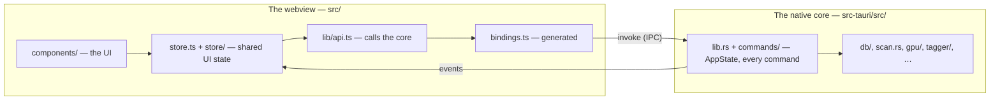
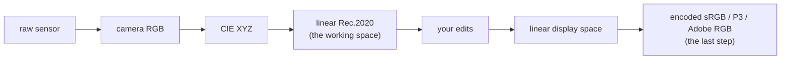

# Understanding this codebase (and learning some Rust along the way)

A guided tour of the whole repository, for someone comfortable with programming
but **new to Rust or React**. It builds the big picture first, then walks every
part, and stops to teach the Rust (and a little React) as it comes up.

Read [ARCHITECTURE.md](ARCHITECTURE.md) first: it has the diagrams of what runs
where. This guide is the walk through the code behind them. The first time,
read top to bottom; after that it works as a map — jump to whatever you're
touching.

---

## Table of contents

1. [The one-paragraph mental model](#1-the-one-paragraph-mental-model)
2. [The two halves and the bridge between them](#2-the-two-halves-and-the-bridge)
3. [How a command actually travels](#3-how-a-command-actually-travels)
4. [The Rust side, module by module](#4-the-rust-side-module-by-module)
5. [How colour and editing work](#5-how-colour-and-editing-work)
6. [The React side, module by module](#6-the-react-side-module-by-module)
7. [Five end-to-end flows](#7-five-end-to-end-flows)
8. [Building, running, testing](#8-building-running-testing)
9. [Rust concepts cheat-sheet](#9-rust-concepts-cheat-sheet)

---

## 1. The one-paragraph mental model

This is a **desktop photo app** built with **Tauri 2**. Tauri apps have two
halves:

- a **Rust core** that does all the real work — reading raw files, running the
  SQLite catalogue, decoding images, running the GPU editing pipeline, running
  the AI models; and
- a **web interface** (React + TypeScript) that is *only* the user interface. It
  draws the grid, the panels and the buttons, and asks the core to do things.

The core is a native program. The interface runs inside the operating system's
own webview (an embedded browser: WebView2 on Windows, WKWebView on a Mac), in
the same process. They talk over a small, typed bridge. **The single most
useful thing to hold in your head:** the Rust core owns the data and the heavy
lifting; React only displays things and collects input. When React needs
something done, it *asks the core* and waits for the answer.

---

## 2. The two halves and the bridge



Key paths:

| Path | What lives there |
|---|---|
| `src-tauri/src/` | The Rust core. `lib.rs` is the crate root; the commands are in `commands/`, one file per area. |
| `src-tauri/crates/` | The develop core the phone app shares (`sl-develop`), and the phone link (`sl-link`, `sl-protocol`). |
| `src/` | The React interface. `main.tsx` boots it, `App.tsx` is its root component. |
| `mobile/` | The phone app ([MOBILE.md](MOBILE.md)). |
| `src/bindings.ts` | **Generated** TypeScript types and call stubs for every Rust command. Never edit by hand. |
| `src/lib/api.ts` | A thin hand-written wrapper that makes those stubs pleasant to use. |
| `src-tauri/Cargo.toml` | Rust's dependencies and build settings (like `package.json`). |
| `src-tauri/tauri.conf.json` | The app's window, bundle and security settings; `tauri.macos.conf.json` is laid over it on a Mac. |
| `src-tauri/vendor/` | Things built outside Cargo: LibRaw for each platform, ONNX Runtime, bundled models. |
| `scripts/` | The check gate, release, LibRaw vendoring, model evaluation. |
| `docs/` | Everything written down. [docs/README.md](README.md) is the index. |

> **🦀 Rust note — crates and Cargo.** A "crate" is a Rust package. `Cargo.toml`
> lists your dependencies (also crates, from crates.io) and `cargo` is the build
> tool (compile, test, run). It is the exact analogue of `npm` and
> `package.json`, for Rust.

---

## 3. How a command actually travels

This bridge is the heart of the app, so trace one call all the way through.
Say the interface wants some photos by id.

**Step 1 — Rust defines a command.** In `src-tauri/src/commands/browse.rs`:

```rust
#[tauri::command(async)]
#[specta::specta]
pub(crate) fn get_photos_by_ids(
    state: State<'_, AppState>,
    ids: Vec<i32>,
) -> Result<Vec<Photo>, String> {
    let conn = state.conn()?;
    db::photos_by_ids(&conn, &ids).map_err(err)
}
```

There's a lot of Rust in those few lines, and it's representative of *every*
command in the app:

> **🦀 `fn`** declares a function. Parameters are `name: Type`, and the return
> type comes after `->`.
>
> **🦀 The `#[...]` lines are attributes** — annotations that add behaviour.
> `#[tauri::command]` makes this callable from the interface, and `(async)`
> runs it on a worker thread rather than the main one; `#[specta::specta]`
> puts its types into the generated `bindings.ts`. Every command has the pair.
>
> **🦀 `pub(crate)`** makes the function visible to the rest of the crate, so
> `lib.rs` can list it, but not outside it.
>
> **🦀 `Vec<i32>`** is a growable array ("vector") of 32-bit integers.
> `Vec<Photo>` is a vector of `Photo` structs. Angle brackets are generics, the
> same idea as `Array<number>` in TypeScript.
>
> **🦀 `Result<Vec<Photo>, String>`** is the most important Rust type to
> understand. Rust has no exceptions. A function that can fail returns a
> `Result`, which is *either* `Ok(value)` or `Err(error)`, and the compiler
> makes the caller deal with both. This is why Rust programs rarely crash on an
> unhandled error.
>
> **🦀 The `?` in `state.conn()?`** is the "try" operator: if the `Result` is
> `Ok`, unwrap the value and carry on; if it's `Err`, return that error from this
> function now. It's everywhere.
>
> **🦀 `&conn`** passes a *reference* — see the ownership note in §4.
>
> **🦀 `.map_err(err)`** converts the error type. The database fails with its own
> error type; the interface only understands strings, so the small helper `err`
> (in `commands/common.rs`) turns it into one that can cross the bridge as JSON.

**Step 2 — the command is registered.** In `specta_builder()` in `lib.rs`:

```rust
tauri_specta::Builder::<tauri::Wry>::new().commands(tauri_specta::collect_commands![
    commands::export::export_space_check,
    commands::app::take_opened_folders,
    // …234 commands in all
])
```

`collect_commands!` wires these up so the webview can call them, **and** is the
list the binding generator reads. So a new command must be added here *and* the
bindings regenerated (§8), or the interface can't see it.

**Step 3 — TypeScript gets a generated stub**, in `src/bindings.ts`:

```ts
getPhotosByIds: (ids: number[]) => typedError<Photo[], string>(__TAURI_INVOKE("get_photos_by_ids", { ids })),
```

The Rust `Result<Vec<Photo>, String>` became a typed `Photo[]` or `string` error, and
`get_photos_by_ids` became `getPhotosByIds`. specta does that translation, so
the two languages always agree on the shapes.

**Step 4 — a friendly wrapper.** `src/lib/api.ts` turns each result into a normal
promise that resolves or throws:

```ts
getPhotosByIds: (ids: number[]) => unwrap(commands.getPhotosByIds(ids)),
```

**Step 5 — a component or store action calls it:**

```ts
const photos = await api.getPhotosByIds([1, 2, 3]);
```

That's the whole loop. **Every feature is some version of these five steps.**

There is a second channel going the other way: **events**. For long jobs
(scanning, tagging, downloading a model) Rust doesn't return once at the end —
it `emit`s progress (`"scan-progress"`, `"caption-progress"`,
`"ai-download-progress"`…) and the interface `listen`s to move a progress bar.
A third carries images, which are too big for JSON: the custom URL schemes
`thumb://`, `full://` and `develop://`, which an `` or canvas loads
directly.

---

## 4. The Rust side, module by module

Rust code is organised into **modules**. `lib.rs` declares them at the top:

```rust
pub mod db;
pub mod scan;
pub mod tagger;
// …
```

> **🦀 `mod` and `pub`.** `mod db;` means "there's a module called `db`; find it
> in `db.rs` or, as here, `db/mod.rs`". `pub` makes something visible outside
> its module; without it, it is private. Rust is private by default, which keeps modules
> honest about what they expose. `db::photos_by_ids(...)` calls into one — `::`
> is Rust's namespace separator.

Here is the whole core, grouped by job. You don't need to read every file; this
is the map. [ARCHITECTURE.md §4](ARCHITECTURE.md#4-the-rust-core-by-responsibility)
has it as a diagram.

### 4a. The hub and shared state

- **`main.rs`** — a tiny entry point that calls into the library. Almost
  everything lives in the library so it can be tested, and reused by the
  developer tools in `src/bin/`.
- **`lib.rs`** (~900 lines) — **the crate root.** It declares the modules,
  defines the `AppState` struct, lists every command in `specta_builder()`,
  and holds startup (`run()`), where the three URL schemes are registered, and
  the run loop that handles quitting and folders dropped on the Dock icon.
- **`commands/`** (~9,400 lines) — **every `#[tauri::command]`**, one file per
  area: `browse.rs` (the photos in view, facets, search), `library.rs`
  (folders and scans), `import.rs`, `cull.rs`, `develop.rs`, `render.rs`
  (Develop's frames on `develop://`), `masks.rs`, `presets.rs`, `export.rs`,
  `metadata.rs`, `sidecars.rs`, `people.rs`, `places.rs`, `colours.rs`,
  `collections.rs`, `tagging.rs`, `ai.rs` (AI setup and the vision model's
  server), `backups.rs`, `phone.rs`, `app.rs` (diagnostics, updates,
  quitting, licences) and `protocols.rs` (`thumb://` and `full://`). Helpers
  more than one area uses are in `common.rs`. When you want to know "what can
  the interface ask the core to do?", this folder is the answer. The real
  work is delegated to the modules below.
- **`AppState`** — the core's shared, long-lived state. One instance for the
  whole app:

  ```rust
  pub struct AppState {
      db_path: PathBuf,
      cache_dir: PathBuf,
      cancel_tagging: AtomicBool,
      vlm_server: std::sync::Mutex<Option<(String, std::process::Child)>>,
      develop: std::sync::Mutex<Option<develop::DevelopState>>,
      jobs: jobs::Jobs,
      // …about thirty fields
  }
  ```

  > **🦀 struct.** A record type — named fields with types, like a TypeScript
  > `interface`, except it is the real data, not just a shape.
  >
  > **🦀 `Mutex<Option<T>>`.** Two ideas stacked. `Option<T>` is Rust's "maybe a
  > value": `Some(value)` or `None`. Rust has **no `null`**, so "might be
  > absent" is in the type, and the compiler makes you handle `None`.
  > `Mutex<T>` is a lock: commands run on different threads, so shared mutable
  > state must be behind one. `Mutex<Option<(String, Child)>>` reads as "a
  > lockable slot that may hold a model's name and a running child process" —
  > the `llama-server` running the vision model.
  >
  > **🦀 `AtomicBool`** is a boolean that threads can read and write without a
  > lock — just right for a "please stop" flag a long job checks between photos.

- **`jobs.rs`** — long jobs register under a name (`index`, `faces`,
  `vlm-model`…) so the Activity panel can offer **Cancel** for any of them
  through one command. Cancelling is cooperative: the job checks its token
  between chunks and cleans up after itself.
- **`sync.rs`** — `lock_recover`, a lock that survives a panic in another
  thread instead of cascading it.
- **`src-tauri/crates/`** — three crates of their own. `sl-develop` is the
  develop core the phone app shares: the edit model (`develop/`), the GPU
  pipeline (`gpu/`), photos that aren't raw (`raster.rs`), the raw decode
  contract and embedded previews (`raw/`) and EXIF (`exif_read.rs`).
  `lib.rs` re-exports it under the same names, so the app reads `crate::gpu`
  as before, and the app's own `develop/` and `raw/` add what only the
  desktop does: LibRaw, the AI masks and Develop's live state. `sl-link` and
  `sl-protocol` are the phone link. The sections below mark what lives in
  `sl-develop`.

### 4b. The catalogue

- **`db/`** (~16,700 lines in 26 files) — everything SQLite. The whole
  library index is one file, `library.db`, in the app's data folder. The
  queries are one file per area of the catalogue (`photos.rs`, `folders.rs`,
  `tags.rs`, `keywords.rs`, `faces.rs`, `people.rs`, `places.rs`,
  `collections.rs`…), and `db/mod.rs` opens the database and re-exports them
  all, so callers write `db::photos_by_ids(...)` whatever file it is in.
  - `MIGRATIONS`, in `migrations.rs` — one SQL string per schema version (52
    so far). At startup the app runs only those it hasn't run yet (tracked by
    SQLite's `user_version`), after taking a backup. To change the schema you **append** a migration;
    you never edit an old one.
  - `PHOTO_COLUMNS` and `row_to_photo`, in `query.rs` — the one place that
    says which columns make a `Photo`. Add a field to `Photo` and you touch
    these two.
  - Small, focused queries the commands call: `photos_by_ids`, `set_caption`,
    `untagged_photos`, the facet counts behind the filter rail, and so on.
  - **Connections:** each command opens its own short-lived connection (SQLite
    is in WAL mode, which makes that cheap), instead of sharing one behind a
    lock that would make the interface stutter during a long scan.
- **`models.rs`** — the types shared with the interface: `Photo`, `PhotoFilter`,
  `TagResult`, `ScanResult`… They derive `Serialize` and `specta::Type` so they
  cross the bridge.
- **`backup.rs`** — the catalogue is the only copy of everything a user decided,
  so risky moments (a migration, a re-tag) take a snapshot first, and Settings →
  Library restores any of them.
- **`fts.rs`** — turns search-box text into a *safe* SQLite full-text query
  (each word quoted, so typing `OR` or `*` can't break anything). Pure and
  unit-tested.

A migration is just SQL text, run once, in order:

```rust
const MIGRATIONS: &[&str] = &[
    // 1 — initial schema
    r#"CREATE TABLE photos ( id INTEGER PRIMARY KEY, path TEXT NOT NULL UNIQUE, … );"#,
    // …
    r#"ALTER TABLE photos ADD COLUMN caption TEXT; …"#,
];
```

> **🦀 raw strings.** `r#"…"#` is a *raw string* — no escaping inside, so SQL
> with its quotes drops straight in. `&[&str]` is a borrowed slice of borrowed
> strings: a fixed list the program reads but never owns.
>
> **🦀 derive.** `#[derive(Serialize, Clone, specta::Type)]` above a struct
> generates code: `Serialize` = "can become JSON", `Clone` = "can be
> duplicated", `specta::Type` = "export me to TypeScript".

### 4c. Getting photos in

- **`scan.rs`** — walks a library folder, finds photo files, and for each one
  extracts a preview and metadata, scores focus, and upserts a row. Re-scans
  skip unchanged files, follow renamed folders and mark missing ones.
- **`raw/`** — raw files. `raw/libraw.rs` binds to **LibRaw**, the C library that
  reads every major camera's format. The key trick is in `raw/mod.rs` (in
  sl-develop): for the library, the app pulls out the full-size JPEG preview
  every raw embeds instead of decoding the sensor, which is what makes
  indexing thousands of files fast.
  LibRaw is LGPL, so it stays a separate, dynamically linked library (`.dll` /
  `.dylib`); see [LIBRAW.md](LIBRAW.md) before touching it.
- **`raster.rs`** (in sl-develop) — photos that aren't raw: JPEG, PNG, TIFF,
  WebP, and HEIC. HEIC goes through the operating system's own codec — `raster/wic.rs` on
  Windows, `raster/imageio.rs` on a Mac — and `raster/icc.rs` reads colour
  profiles, so an Adobe RGB or Display P3 photo shows in its true colours.
  Cameras embed no profile: one set to Adobe RGB says so only in EXIF or its
  maker notes (`exif_read::ColourSpace`), for its JPEGs and for the previews
  inside its raws, and the grid converts from that.
- **`exif_read.rs`** (in sl-develop) — camera, lens, exposure and date from EXIF.
- **`ingest.rs`** — **Import from card**: copies a memory card into dated
  folders, verified, skipping what's already imported. The card is only read.
- **`quality.rs`** — focus (variance of a Laplacian) and brightness scores,
  classical computer vision, no model. Cull uses them to suggest rejects.
- **`dedup.rs`** — finds byte-identical copies (the same card imported twice).
- **`full_preview.rs`** — the full-resolution pixels for a 1:1 zoom, extracted
  on demand for the one photo being looked at.

### 4d. Places and time

- **`geo.rs`** — GPS coordinates to "Edinburgh, United Kingdom", offline, from
  an embedded list of ~34,000 towns.
- **`gpx.rs`** — places photos from a GPX track recorded on a phone, matching
  capture times (and guessing the camera's clock offset).
- **`trips.rs`** — groups photos by gaps in shooting time, so a camera with no
  GPS needs a handful of trips named rather than hundreds of photos tagged.

### 4e. Develop and export

The most advanced part; you can treat it as a black box until you need it.
§5 explains how it works.

- **`develop/`** (in sl-develop) — the non-destructive editor's *model*.
  `stack.rs` is the **edit stack**: a few hundred bytes of JSON describing
  every adjustment. Each other file is one tool: `tone.rs`, `curve.rs`,
  `mixer.rs`, `grading.rs`, `detail.rs`, `geometry.rs`, `lens.rs`, `spot.rs`,
  `effects.rs`, `film.rs`, `mask.rs` (masks), `look.rs`, `lut.rs`,
  `lut_packs.rs` and `presets.rs` (looks, LUTs and presets), `auto.rs` (auto
  tone and white balance). The app's own `develop/` adds AI masking in `ai.rs`
  and `sam2.rs`, and `session.rs`, which holds the photo currently open. The
  raw file is never modified.
- **`gpu/`** (in sl-develop) — the rendering, with **wgpu** (a Rust GPU
  library that runs on Metal, DirectX 12 or Vulkan) and **WGSL** shaders: `mosaic.wgsl` (demosaic),
  `develop.wgsl` (every adjustment) and `downsample.wgsl`. `pipeline.rs` drives
  them; `golden.rs` supports tests that catch a shader quietly changing output.
- **`present/`** — getting a rendered frame onto the screen. The portable
  **readback** presenter reads the frame back and serves it over `develop://`,
  on every platform. On a Mac the live preview is instead drawn straight into
  a Metal layer beneath the page (`appkit.rs`, driven from
  `src/lib/directCanvas.ts`), which also shows a slider's value — and the
  split view — while it is dragged. The Windows child-window version (`win32.rs`) is built but not
  switched on. The rule: platform code for drawing lives here and nowhere else.
- **`export/`** — renders a finished file (JPEG, PNG, TIFF, WebP) through the
  *same* shader at full resolution, then resizes, tags it with an ICC profile
  (`icc.rs`, built from the standard's numbers rather than shipped), writes
  EXIF and IPTC (`exif.rs`, `xmp.rs`), and runs batches (`batch.rs`).

  > **🦀 `#[cfg(...)]` — conditional compilation.** `#[cfg(windows)]` means
  > "only compile this on Windows"; `#[cfg(target_os = "macos")]` the same for a
  > Mac. It's how one codebase carries platform-specific bits. They are kept to a
  > few named places (see [ARCHITECTURE.md §4](ARCHITECTURE.md#4-the-rust-core-by-responsibility)),
  > so porting stays a small job.

### 4f. On-device AI

Every AI feature is optional and runs on the machine.

- **`ai_setup.rs`** and `ensure_ai_ready` in `commands/ai.rs` — **the readiness ladder**.
  Whatever you clicked, it works out what's missing (a model, the runtime, a
  running server), asks once if a download is needed, fetches it, and loads it.
  The interface calls it before every AI feature (`lib/aiReady.ts`).
- **`ai_models.rs`** — the catalogue of ONNX models (SigLIP 2 for search and
  tags, YuNet, MediaPipe's face mesh and blendshapes, and AuraFace for faces,
  BiRefNet and SAM 2 for AI masks), each
  pinned to a version and SHA-256, and a streaming downloader. A model can
  have a variant in another precision, which a PC downloads instead when it
  runs it better: BiRefNet in fp16 for DirectML, SigLIP 2's vision tower in
  fp32 for a PC with no GPU. They run in-process through **ONNX Runtime**
  (`ort` crate; DirectML on Windows, CoreML on a Mac, or the CPU). The
  sessions are built in `develop/ai.rs`: none spins its threads, and
  automatic analysis's run below normal priority (`cpu_threads`).
- **`tagger/`** — tagging and descriptions behind one **trait**:

  ```rust
  #[async_trait]
  pub trait Tagger: Send + Sync {
      async fn tag(&self, image: &[u8]) -> Result<TagResult>;
      async fn check(&self) -> Result<()>;
      async fn caption(&self, _image: &[u8]) -> Result<String> { /* default: unsupported */ }
      async fn tag_and_caption(&self, image: &[u8]) -> Result<(TagResult, String)> { /* default: both calls */ }
      async fn warm(&self) -> Result<()> { Ok(()) }
      async fn unload(&self) -> Result<()> { Ok(()) }
      fn max_concurrency(&self) -> usize { 1 }
  }
  ```

  > **🦀 trait.** A set of methods a type promises to provide — like a
  > TypeScript `interface`, but it can carry *default* implementations. Here
  > `caption`, `tag_and_caption` and `warm` have defaults, so a
  > provider overrides them only if it can do better — the vision model
  > overrides `tag_and_caption` to ask for both in one request, reading the
  > image once. `builtin.rs` (SigLIP 2, in-process) and `llama.rs` (a vision
  > model on the app's own `llama-server`) each `impl Tagger for …`. Code
  > elsewhere holds a `Box<dyn Tagger>` — "some tagger, chosen at runtime" —
  > and calls `.tag(...)` without caring which.
  >
  > **🦀 `async` / `.await`.** An `async fn` returns a *future*, a computation
  > that runs later — used for I/O that would otherwise block, like an HTTP call
  > to `llama-server`. `.await` it to get the result. Same model as TypeScript.
  >
  > **🦀 `&self` and `&[u8]`.** `&self` means the method borrows the object.
  > `&[u8]` is a *slice*, a borrowed view of bytes — here the image.

  `tagger/mod.rs` also holds the JSON schema a vision model must answer in. Its
  **property order is load-bearing**: `main_subject` comes before `genre`,
  because models answer in schema order and committing to the subject first
  stops them calling everything "landscape". A test guards it.
- **`search.rs`** — search by content: each photo's SigLIP 2 embedding is stored
  in the catalogue, a typed query is embedded with the matching text encoder,
  and photos rank by cosine similarity. Also near-duplicate grouping.
- **`faces.rs`** and **`people.rs`** — find faces (YuNet), score focus, read
  whether the eyes are open (MediaPipe face mesh and blendshapes, with "can't
  tell" for faces it can't read), embed each (AuraFace), then group embeddings
  into people with average linkage. The grouping and the eye rule are pure and
  unit-tested. Grouping compares every face with every other, so its pairwise
  pass runs on every core.
- **`vector.rs`** — the dot product that search, near-duplicates, tagging and
  people all compare embeddings with, summed in sixteen lanes so the compiler
  can use SIMD (a single running float sum it cannot).
- **`vlm.rs`** — the vision-model catalogue (Qwen3-VL 2B, 4B, 8B, and the older
  qwen2.5vl 7B), and pure logic that grades each against the machine's GPU
  memory: `fit(min_vram, vram) -> WillRun | Tight | TooLarge | Unknown`, and
  `recommended(vram)`.

  > **🦀 enum + match.** `Fit` is an `enum`, a type that is *one of* a fixed set
  > of variants. You handle one with `match`, a `switch` the compiler forces to
  > be exhaustive:
  > ```rust
  > match fit {
  >     Fit::WillRun  => "green",
  >     Fit::Tight    => "amber",
  >     Fit::TooLarge => "red",
  >     Fit::Unknown  => "grey",
  > }
  > ```
  > Forget a variant and it won't compile — a quietly huge safety feature.

- **`hardware.rs`** — what the machine can do: the GPU wgpu picks, CPU threads,
  GPU memory (DXGI on Windows; on a Mac, 70% of the unified memory), free disk
  space, and whether the connection is metered. Its `recommend` logic is pure
  and tested. `directml_gpu` says whether the models have a GPU on Windows,
  which picks the precision they download in, and `BackgroundPriority`
  lowers a background pass's thread while it runs.
- **`sidecar.rs`** and **`llama_pack.rs`** — the vision model's server.
  `llama_pack.rs` downloads llama.cpp's official `llama-server` on request
  (a pinned build, checked hash: the Vulkan build on Windows, Metal on a Mac)
  into the app's data folder; `vlm.rs` lists the models, Qwen's own GGUFs,
  fetched by `ai_models.rs`'s downloader. `sidecar.rs` starts the server on
  a free loopback port, with a key made for each run, on the right GPU, with a tag image costing ~260 tokens
  and up to four photos at once, and stops it when idle or on quit. On Windows
  it also runs in a job object the app holds until it exits, so it ends with
  the app even after a crash (`die_with_app`). It replaced a private Ollama,
  whose API made every photo two to six times slower: see
  `docs/AI-MODEL-SPIKES.md`.

### 4g. Interop and the app itself

- **`xmp.rs`** — `.xmp` sidecars to and from Lightroom and digiKam: ratings,
  labels, keywords, people and face regions, picks, captions.
- **`shell.rs`** — Show in Finder / Explorer, and moving rejects to the Trash /
  Recycle Bin (never deleting outright).
- **`updates.rs`** — the self-updater, off until a signing key is configured
  ([UPDATES.md](UPDATES.md)).
- **`crash.rs`** — crash and interface error logs a user can find and send.
- **`seed.rs`** and `src/bin/seed_library.rs` — build a 50,000-photo synthetic
  catalogue to test the app at scale ([BENCHMARKS.md](BENCHMARKS.md)).
- **`src/bin/probe_ai.rs`** — times each on-device model, alone or through
  the app's own code, on the CPU, an integrated GPU or the main one, with
  its peak memory: how [BENCHMARKS.md](BENCHMARKS.md#slower-machines-2026-10-11)
  measured slower machines.

### An aside on ownership — the one Rust idea worth internalising

> **🦀 Ownership & borrowing.** Every value in Rust has a single *owner*. When
> the owner goes out of scope the value is freed — no garbage collector, no
> manual `free`. To use a value somewhere else without giving up ownership, you
> *borrow* it with `&` (a reference). Borrows are either shared and read-only
> (`&T`, many at once) or exclusive and writable (`&mut T`, one at a time), and
> the compiler checks all of this before the program runs. That's why you see
> `&conn`, `&ids` and `&self` everywhere: the function only needs to *look at*
> the value. This rule is what gives Rust memory safety without a garbage
> collector, and it's the part that feels strangest at first. When the compiler
> complains about "moved" or "borrowed" values, it's enforcing this — and it's
> usually right.

---

## 5. How colour and editing work

The develop module is where a raw file becomes a finished image. Two ideas
govern it: **edits are data, not pixels**, and **the real colour work happens
on the GPU in a wide, linear space.**

### Edits are data, never pixels

Your raw file is *never* modified. Everything you do is recorded in an **edit
stack**, a struct serialised to JSON in the photo's `develop_settings` column.
Abridged from `develop/stack.rs`:

```rust
#[derive(Serialize, Deserialize, specta::Type)]
#[serde(rename_all = "camelCase", default)]
pub struct EditStack {
    pub version: u32,
    /// Exposure in stops. Applied as a linear multiply of `2^exposure`.
    pub exposure: f32,
    /// White balance relative to the camera's as-shot setting: the light the
    /// photo is adapted from, moved by temperature — the same on every camera.
    pub warmth: f32,
    pub tint: f32,
    // …tone, curves, colour mixer, grading, detail, masks, crop and more
}
```

> **🦀 forward compatibility.** `#[serde(default)]` plus a `version` is the whole
> mechanism. A stack saved today must still load after the module grows twenty
> more parameters, so a *missing* field means "use the default", never a crash.
> And because a stack is so small, undo history stores *whole snapshots* rather
> than a list of commands: simpler, and impossible to get subtly wrong.

### The colour journey

A pixel passes through several colour spaces on its way to your screen:



The **working space is linear Rec.2020**: wide enough to hold any camera's
colours without clipping, and built from real primaries. The matrices live in
`gpu/color.rs`:

```rust
/// CIE XYZ (D65) to linear Rec.2020.
pub const XYZ_TO_REC2020: Mat3 = [
    [1.7166512, -0.3556708, -0.2533663],
    [-0.6666844, 1.6164812, 0.0157685],
    [0.0176399, -0.0427706, 0.9421031],
];
```

Two words carry this section: **linear** and **encoded**. Sensors and physics
are linear — double the light, double the number. Screens and files are
gamma-encoded, spending more precision in the shadows where eyes are most
sensitive. So all the maths happens in linear light, and the encode is the very
last step; do it in the wrong order and every adjustment looks subtly off. (The
camera→XYZ matrix differs per camera and comes from LibRaw, so there's no table
to maintain.)

What a raw's numbers mean is settled once, as it is decoded (`raw/libraw.rs`):

- **Which matrix.** A DNG's own calibration, combined as the DNG specification
  says — two illuminants' matrices interpolated at the scene's colour
  temperature, forward matrices, per-unit calibration (`raw/colour.rs`). For
  any other raw, LibRaw's table; then the camera's own matrix; then a generic
  sensor, so a body newer than LibRaw still opens.
- **Where white is.** The level each channel really saturates at, which is not
  always the format's ceiling (`raw/levels.rs`): a Canon R6 writes 14-bit files
  but clips at 14008. Get it wrong and blown highlights never reach full scale,
  where the mosaic pass recognises them.
- **Which white balance.** As shot; daylight from the matrix when the file has
  none; nothing when the camera applied it already.
- **Lens shading.** A DNG can carry its lens's vignetting and colour shading as
  opcodes — a phone's or a drone's always does — and they are applied to the
  sensor data before anything else sees it (`raw/opcodes.rs`).
- **How bright it opens.** Where the camera's own JPEG put the frame: the
  median of the preview inside the raw, matched on a small render when the
  photo is prepared (`Pipeline::open_at_camera`). Bodies meter a stop apart,
  so no one constant can do this. Exposure 0 is that placement; an edit saved
  before it existed (edit-stack version 1) keeps the placement it was made
  against.

A photo that isn't raw joins the same pipeline after the demosaic: its pixels
are linearised through its own colour profile and uploaded as the linear image.
So does a **linear DNG** (ProRAW, Lightroom's Enhanced files), which arrives
already demosaiced.

### It runs on the GPU, in two passes

- **Mosaic** (`mosaic.wgsl`): demosaic the raw sensor data into a linear
  camera-RGB texture. Done once when a photo opens, and cached. A short pass
  after it (`highlights.wgsl`) rebuilds highlights blown in one channel from
  the colour measured around them, and whitens the rest, as the pink of a
  blown sky otherwise needs.
- **Develop** (`develop.wgsl`): everything you adjust, ending with the display
  encode. This re-runs on *every* interaction, which is why it lives on the
  GPU: it has to feel instant. The order inside it is the product, straight from
  the shader:

  ```wgsl
  // Stage order is the product. Exposure is a linear-light multiply and must
  // happen before the colour transform; the display encode must be last.
  ```

### Sliders become lookup tables

The tone sliders (contrast, highlights, shadows, whites, blacks) *never reach
the shader directly*. The CPU (`tone.rs`) **bakes** them into a small lookup
table that the shader samples per pixel — as `stack.rs` puts it, "the shader
never sees them directly, only the baked LUT". Evaluating five interacting curves
once on the CPU is far cheaper than per pixel on millions of pixels. The colour
mixer and grading wheels use the same trick. The mixer's table is indexed by
hue in OkLCh (`develop/oklab.rs`), a space where equal steps look equal, so a
band is the colour it is named for and each slider moves only hue, chroma or
lightness; the camera's look profile keeps its own row in the HSV hue it was
measured in.

### One load-bearing detail: uniform alignment

The shader reads its settings from a `Params` **uniform**, a read-only struct
shared between Rust and WGSL. GPUs have strict alignment rules, and both sides
must agree byte for byte:

```wgsl
struct Params {
    // Columns are vec4-aligned: WGSL gives mat3x3 a 16-byte column stride, so
    // the Rust side pads to match. Getting this wrong shears the colour matrix
    // and tints the whole image.
    cam_to_working: mat3x3<f32>,
    working_to_display: mat3x3<f32>,
    exposure: f32,
    // …
}
```

> **🦀 the CPU/GPU contract.** A uniform is read-only data handed from the CPU to
> a shader. That comment is a real war story: if the Rust struct's padding
> doesn't match WGSL's, the matrix columns misread and the whole image tints.

### Getting it on screen, and out

Each frame is read back from the GPU and served to the canvas over
`develop://` — about 5 ms per slider step on an M4. Export runs the same shader
at full resolution and tags the file with an ICC profile (sRGB, Display P3 or
Adobe RGB) so every other app reads the colours as intended.

---

## 6. The React side, module by module

The interface is plain React + TypeScript, styled with Tailwind. Its job is
display and input only.

- **`main.tsx`** — boots the app: installs the menu bar on a Mac (`lib/appMenu.ts`),
  Dock progress, the quit guard, folder drops, then mounts `<App/>`. The window
  starts hidden and is shown once the interface has painted.
- **`App.tsx`** — the shell. The **mode rail** on the left switches between four
  workspaces; above them sits at most one full-screen overlay at a time; and
  dialogs, the command palette and settings live here too. It also
  listens for the progress events that feed the Activity panel.

  > **⚛️ Component.** A React component is a function that returns UI, written in
  > JSX (HTML-like syntax inside TypeScript). Components nest.
  >
  > **⚛️ Hooks.** `useState` holds a piece of local state; `useEffect` runs a side
  > effect (like subscribing to an event) when the component mounts or its
  > inputs change.

- **`store.ts`** and **`store/`** — **the single source of shared UI state**,
  using a small library called **Zustand**: the loaded photos, the filter, the
  selection, the open overlay, running jobs — plus the *actions* that change
  them, which usually call `api.*` and then update state. Each area is a slice
  in `store/` (`library.ts` for the photos, filter and grid, `selection.ts`,
  `develop.ts`, `ai.ts`, `export.ts`…); `store.ts` (~160 lines) puts them
  together into one store and saves the preferences among them, and
  everything imports the store from there. "Where does the UI keep X?" is
  almost always answered in `store/`. The AI slice also runs **automatic analysis**
  (`runAnalysis`) after every scan, at launch included: locations, focus, the
  search index, tags, faces and — with Detailed descriptions on — descriptions,
  one after another, each only when the app is idle. Each pass can be switched
  off in Settings › AI (`autoSteps`), and descriptions go a batch at a time
  (`DESCRIBE_BATCH`), so a new import's quicker passes never wait behind a
  library's worth of describing. On battery the vision model's passes wait for
  the charger (`holdOnBattery`, `watchForPower`, `hardware::on_battery`).

  > **⚛️ Why a store.** React state is local to a component by default. The
  > grid, the filter rail and the top bar all need the same filter, so each
  > reads it from the store and re-renders when it changes.

- **`lib/api.ts`** — the wrapper over the generated bindings (§3).
- **`types.ts`** — re-exports generated types and adds interface-only constants.
- **`components/`** — one file per surface:
  - **Workspaces:** `BrowseWorkspace` (grid + `FilterRail`), `CullWorkspace`
    (loupe, survey, suggested picks), `PlacesWorkspace` (map, trips, GPX) and
    `PeopleWorkspace` (naming, merging, review).
  - **Overlays:** `Lightbox` (one photo, with metadata and faces), `CompareView`
    (side by side, duplicates and bursts), and `Develop`. Develop's header,
    panels and canvas overlays are in `components/dev/` (`AdjustPanel`,
    `CropPanel`, `Filmstrip`, `Histogram`, `MaskOverlay`, `SpotOverlay`…), and
    its larger editors sit beside it in `components/` (`MaskPanel`,
    `CurveEditor`, `GradingWheels`, `DevelopPresets`).
  - **Around them:** `PhotoGrid` (virtualised: only visible rows are rendered),
    `TopBar`, `ModeRail`, `ActivityPanel`, `CommandPalette` (Ctrl/⌘+K),
    `ImportDialog`, `ExportDialog`, and `SettingsPanel` with its tabs
    (`AiSection`, `LibrarySection`, `ExportRightsSection`, `AboutSection`…).
- **`lib/` — the testable core of the interface.** Pure logic pulled out of
  components so it can be unit-tested without a browser, each with a `.test.ts`
  beside it: `keymap.ts` (rebindable shortcuts), `queryReading.ts` (turning
  "Anna in Edinburgh last summer" into filters), `survey.ts` (compare maths),
  `stacks.ts` (bursts), `suggest.ts` (cull suggestions), `calendar.ts`,
  `curve.ts`, and more. **When a component needs real logic, put it here with a
  test, not inline in the component.**
- **`dev/mockBackend.ts`** — a fake 48-photo backend, used when `npm run dev`
  serves the interface to a plain browser with no Tauri behind it.

A store action almost always has this shape — call the core, then `set` state
so the interface re-renders. The library reload in `store/library.ts`, abridged:

```ts
reload: async () => {
  set({ loading: true });
  try {
    const filter = get().committedFilter;
    const [photos, facets] = await Promise.all([
      api.getPhotos(filter, PAGE, 0),
      api.getFacets(filter),
    ]);
    set({ photos, facets });          // ← every component reading these re-renders
  } finally {
    set({ loading: false });
  }
},
```

> **⚛️ Zustand.** `set({…})` writes into the shared store, and any component
> reading `photos` or `facets` re-renders; `get()` reads the current state. This
> "call `api.*`, then `set` the result" loop is the whole relationship between
> the interface and the core.

---

## 7. Five end-to-end flows

Tracing real features is the fastest way to see the layers cooperate.
[ARCHITECTURE.md §3](ARCHITECTURE.md#3-what-happens-when) has three of these as
sequence diagrams.

### Flow A — adding a folder
1. **Add folder…** in the library menu (or a folder dropped on the window, or on
   the Dock icon) → store `addLibraryFolder` → `api.addLibraryFolder`, then
   `runScan`.
2. Rust `scan_library` (`commands/library.rs`) walks the folder off the async
   threads (`scan.rs`), extracting previews (`raw/`, `raster.rs`) and EXIF, and
   upserts rows (`db/photos.rs`), emitting `"scan-progress"`.
3. Afterwards it names places from GPS (`geo.rs`) and returns counts, including
   the first reason any photo couldn't be read.
4. The store reloads the grid, then `runAnalysis` fills in what AI can:
   the search index, tags and faces, then descriptions a batch at a time.

### Flow B — applying a filter
1. You tick "Landscape" in `FilterRail.tsx` → store `setFilter`.
2. The store debounces, then calls `api.getPhotos` and `api.getFacets` together.
3. Rust builds one SQL query from the combined filters and returns the photos
   **plus sibling-aware counts**: each option's count is computed against the
   *other* active filters, so options never collapse to zero when you pick one.
4. The grid and the rail re-render from the new state.

### Flow C — searching by what you remember
1. You type "Anna at the beach last summer" and press Enter.
2. `lib/queryReading.ts` recognises "Anna" (a person), "last summer" (a date
   range) and leaves "beach" as content to search for; each becomes a chip.
3. The core embeds "beach" with the SigLIP 2 text encoder, ranks photos by
   similarity (`search.rs`), fuses that with caption text matches (`fts.rs`),
   and applies the person and date filters.

### Flow D — describing photos with a vision model
1. Settings → AI → **Detailed descriptions: On** → `ensureAi("captions")` →
   `ensure_ai_ready` (`commands/ai.rs`). The backend picks a model for the
   machine's GPU memory (`hardware.rs`, `vlm.rs`) and reports what must
   download.
2. One dialog names the runtime and the model and their total size. On **yes**,
   the runtime is downloaded and verified (`llama_pack.rs`), the model
   downloaded and verified (`vlm.rs`, `ai_models.rs`), and the server started
   on it (`sidecar.rs`) and loaded.
3. **Describe** → `start_captioning` sends each photo to the model through
   `tagger/llama.rs` — tags and description in one request for a photo not
   yet tagged — stores the text (`db::set_caption`, which keeps the
   full-text index current through triggers), emits `"caption-progress"`, and
   unloads the model when idle.
4. Quitting stops the server politely, so the model's memory is freed with it.

### Flow E — developing and exporting
1. **D** on a photo → `open_develop`: LibRaw decodes the sensor, and the mosaic
   pass demosaics it on the GPU, once.
2. Each slider change → `set_develop_stack`, and the canvas requests the next
   frame over `develop://`; the develop pass renders it in a few milliseconds.
3. **Export** → `export_batch` runs the same shader at full resolution for each
   photo, resizes, tags the colour profile and metadata, and writes the file.

---

## 8. Building, running, testing

All commands run from the repository root. Setup per platform is in
[CONTRIBUTING.md](../CONTRIBUTING.md).

```bash
npm ci                   # npm install only when you are changing dependencies
npm run tauri dev        # the app, without on-device AI
npm run tauri:ai         # the app with on-device AI (what ships)
npm run dev              # the interface alone, in a browser, on the mock backend
```

**The gate is `./scripts/check.sh`.** CI runs most of these checks on every
pull request, on Windows and macOS (`.github/workflows/ci.yml` is the exact
list), but this script is what to run first, on a warm build with a real GPU:
types, formatting, clippy, the frontend and Rust test
suites, the bindings check and the dependency-licence check. `--ai` adds the shipped AI build, `--raw` the
real-raw fixtures, `--upstream` the LibRaw currency check. Run it before
considering anything done. The pieces, one at a time:

```bash
npx tsc --noEmit                                    # interface types
npx vitest run                                      # interface tests
cargo test  --manifest-path src-tauri/Cargo.toml    # Rust tests
cargo clippy --manifest-path src-tauri/Cargo.toml --all-targets -- -D warnings
# After changing a command or a shared type, regenerate the bridge:
cargo run --manifest-path src-tauri/Cargo.toml --features dev-tools --bin export_bindings
```

> **🦀 `cargo test` / `clippy`.** `cargo test` runs every `#[test]` function —
> Rust keeps unit tests in the same file as the code, in a
> `#[cfg(test)] mod tests { … }` block. `clippy` is Rust's linter; this repo
> treats its warnings as errors.

A Rust test is a function tagged `#[test]` beside the code it checks. This one,
from `vlm.rs`, pins the logic the model picker relies on:

```rust
#[test]
fn fit_grades_headroom_borderline_and_over_budget() {
    assert_eq!(fit(8, Some(16384)), Fit::WillRun);   // 16 GB, needs 8
    assert_eq!(fit(12, Some(6144)), Fit::TooLarge);  // 6 GB, needs 12
    assert_eq!(fit(8, None), Fit::Unknown);          // memory unreadable
}
```

**A green `cargo test` alone does not mean every test ran.** Tests that need
real raws, a hardware GPU, downloaded models or a real catalogue *skip* without
them. `check.sh` lists the skips at the end, and fails on a skip of anything the
run declares it has (`SOURCELIGHT_REQUIRE`: `gpu` always, `raw` with
`--raw`). The rules are in `src-tauri/crates/sl-develop/src/test_support.rs`.

**A development catalogue.** A debug build can be pointed at another data
folder with `SOURCELIGHT_DATA_DIR`, so you never touch the real library. A
release build deliberately ignores it; to try a finished build, make the test
variant (`npm run tauri:build:test:mac`), which has its own identifier and so
its own data folder.

**Releasing:** `./scripts/release.sh X.Y.Z` from a clean `main`, with the version
bumped in `tauri.conf.json`, `Cargo.toml` and `package.json` and a `## [X.Y.Z]`
section in `CHANGELOG.md`. It runs the full gate, builds and verifies the
Windows installers, and stages a **draft** GitHub release. The Mac build is
`npm run tauri:build:ai:mac` (see [MACOS.md](MACOS.md)).

### Hard constraints (don't relearn these the hard way)

- **Dependencies are permissive-only.** SourceLight is MPL-2.0 (see `LICENSE`
  and [LICENSING.md](LICENSING.md)), and Rust links statically, so one
  GPL/AGPL/LGPL/CC-BY-SA crate would impose its own terms on the whole binary
  and on everyone who passes it on. `src-tauri/deny.toml` enforces the
  allowlist. LibRaw is LGPL and so stays a **separate dynamic library**,
  asserted by the checks. Every AI model must be MIT or Apache-2.0, pinned and
  checksummed (`ai_models::is_permissive` and its test).
- **Never change the identifier, `app.sourcelight`**: the catalogue's location
  is derived from it. `identity.rs` moved installs from the earlier
  `com.jamestully.photoorganiser`. A few stored names still carry the working
  names "Northlight" and "photo-organiser", because changing them would orphan
  what existing installs saved: the saved-settings key in `src/store.ts`, two
  `northlight.*` local-storage keys, the built-in `northlight-chrome.cube` LUT
  that edits refer to by file name, the LUT-pack marker and the llama.cpp
  runtime manifest.
- **Keep platform code contained.** Presentation lives behind `present/`; the few
  other platform branches (listed in [ARCHITECTURE.md §4](ARCHITECTURE.md#4-the-rust-core-by-responsibility))
  come in Windows/Mac pairs. Don't scatter more.
- **specta forbids 64-bit integers** in IPC types: use `i32`/`u32`/`f64`, or a
  string. JavaScript can't represent them exactly.
- **Tag-schema property order is load-bearing** (subject before genre), protected
  by a test, and needs `serde_json`'s `preserve_order` feature.
- **`DESIGN.md` is authoritative** for the interface: tokens, type, depth and
  layout.
- **`wgpu` and `ort` are pinned deliberately.** Upgrading either is a planned
  change with testing, not a routine bump.

---

## 9. Rust concepts cheat-sheet

| Concept | What it means | Where you saw it |
|---|---|---|
| `fn name(x: T) -> R` | a function: typed parameters, return type after `->` | every command |
| `Result<T, E>` | success `Ok(T)` or failure `Err(E)`; no exceptions | every command |
| `?` | return the error now if there is one | `state.conn()?` |
| `Option<T>` | `Some(T)` or `None`; Rust's replacement for `null` | `Option<Child>` |
| `struct` | a record type with named fields | `AppState`, `Photo` |
| `enum` + `match` | one of several variants; an exhaustive switch | `Fit`, `Provider` |
| `trait` + `impl` | an interface, with optional defaults, that types implement | `Tagger` |
| `Box<dyn Trait>` | "some value implementing this trait, chosen at runtime" | the chosen tagger |
| `&T` / `&mut T` | borrow a value, read-only / exclusive-writable | `&conn`, `&self` |
| ownership | one owner frees the value; no garbage collector | everywhere |
| `async` / `.await` | non-blocking I/O; a future you await | `llama-server` calls |
| `Mutex<T>` / `AtomicBool` | shared state across threads, locked / lock-free | `AppState` |
| `#[derive(...)]` | generate boilerplate (Serialize, Clone, …) | most structs |
| `#[cfg(...)]` | compile only on some platform or feature | `present/`, `raster/` |
| `mod` / `pub` / `::` | modules, visibility, namespacing | top of `lib.rs` |
| `Vec<T>` / `&[T]` | a growable array / a borrowed slice of one | `Vec<Photo>`, `&[u8]` |

### Where to go next, by curiosity

- **"How does a request work end to end?"** — re-read §3, open a file in
  `commands/`, pick any command, and follow it into its module.
- **"How does the database evolve?"** — `db/migrations.rs`, the `MIGRATIONS` array.
- **"How does the AI plumbing work?"** — `ai_setup.rs` and `ensure_ai_ready`
  (`commands/ai.rs`), then `tagger/mod.rs` (the trait) and `tagger/llama.rs`
  (one implementation).
- **"How is pure logic tested?"** — `src-tauri/src/vlm.rs` (Rust) and
  `src/lib/stacks.ts` (TypeScript) both end with small, readable tests worth
  copying.
- **"Why is it like this?"** — the comments beside the code, and the other
  documents in `docs/`, say why wherever the code alone can't. This guide
  says *what*.
